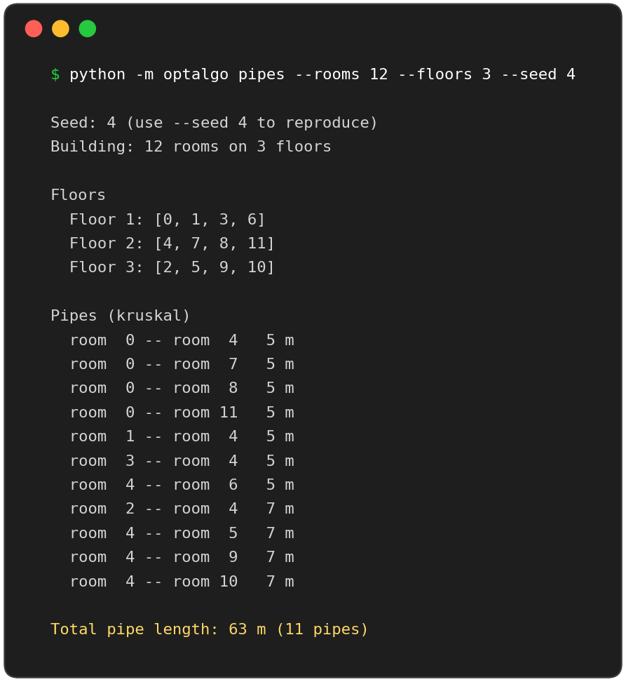
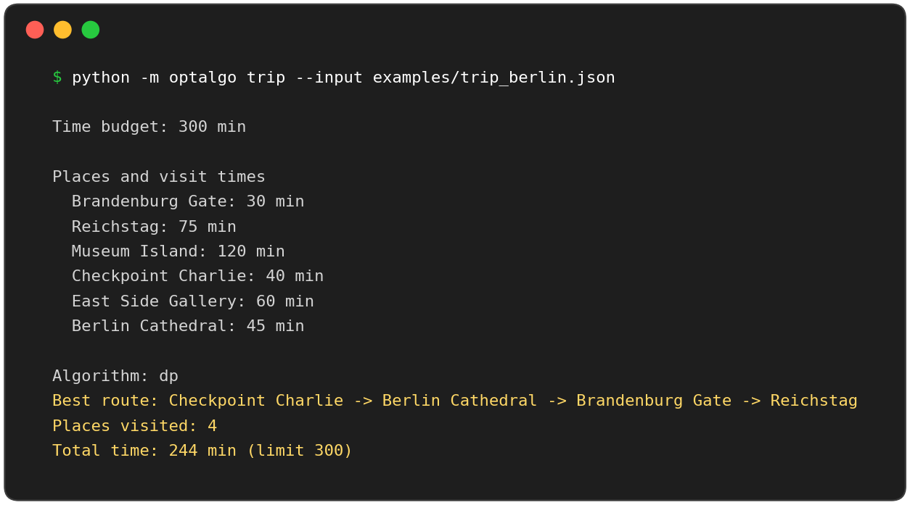
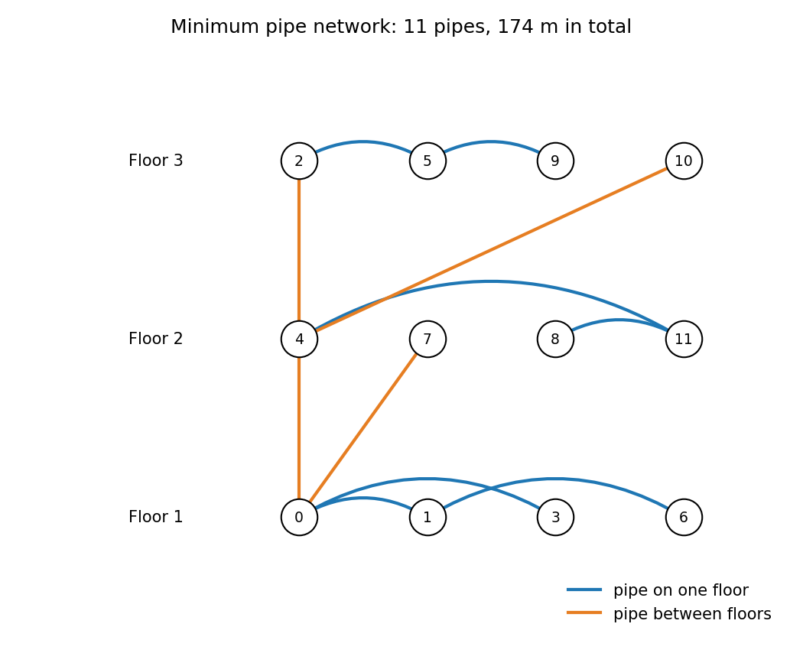
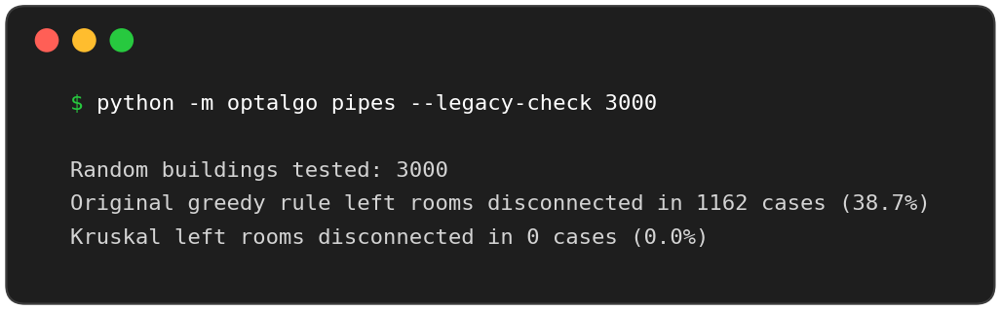
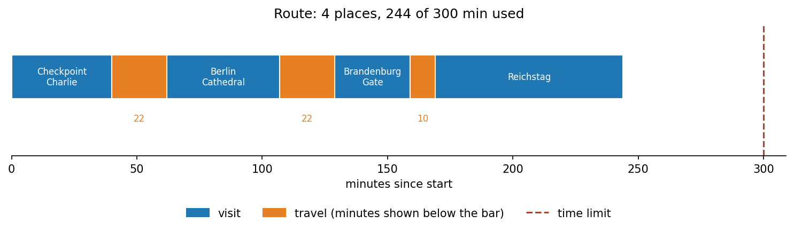
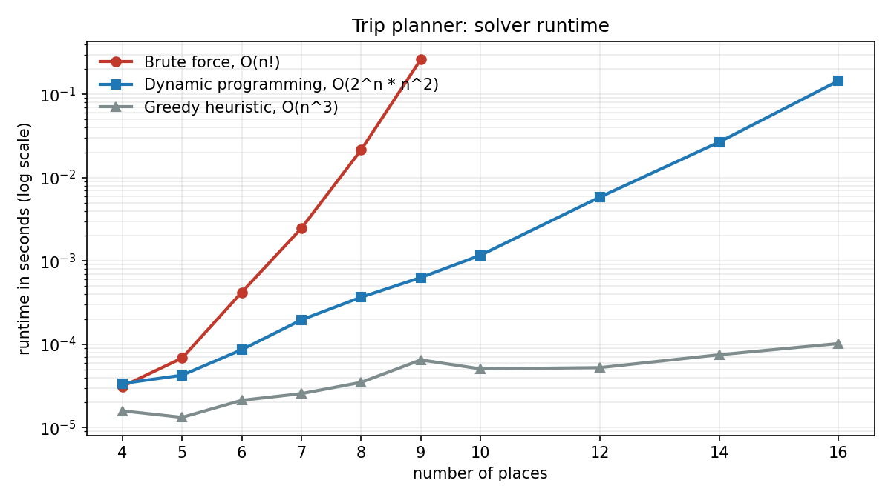
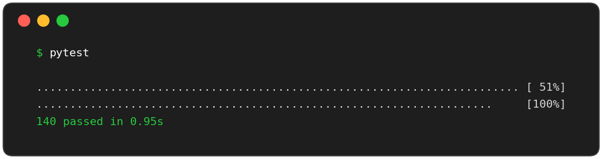

# optalgo


Two classic optimization problems, implemented cleanly in plain Python with a command line interface, charts, a test suite and benchmarks.

| Problem | Technique | Module |
|---|---|---|
| **Pipe network:** connect every room of a multi-floor building with the least pipe | Minimum Spanning Tree: Kruskal + Union-Find, cross-checked with Prim | [`pipe_network.py`](optalgo/pipe_network.py) |
| **Trip planner:** visit as many places as possible within a time budget | Exact dynamic programming over subsets (bitmask), brute force, greedy heuristic | [`trip_planner.py`](optalgo/trip_planner.py) |

The project grew out of two small exercises. The original pipe-network rule could leave the building disconnected, and the original trip search tried every permutation. Both problems are fixed, tested and measured here.

## Contents

- [Quick demo](#quick-demo)
- [1. Pipe network](#1-pipe-network)
- [2. Trip planner](#2-trip-planner)
- [Installation](#installation)
- [Usage](#usage)
- [Tests](#tests)
- [Project structure](#project-structure)
- [Regenerating the pictures](#regenerating-the-pictures)
- [License](#license)

## Quick demo

```bash
python -m optalgo pipes --rooms 12 --floors 3 --seed 4
```



```bash
python -m optalgo trip --input examples/trip_berlin.json --plot docs/trip_route.png
```



## 1. Pipe network

A building has `n` rooms on `m` floors. Rooms on the same floor can be joined by a pipe, and so can rooms on adjacent floors. Choose pipes so that **every room is connected** with the **smallest total length**.

This is the Minimum Spanning Tree problem. Kruskal's algorithm sorts all candidate pipes by length and keeps a pipe only if its two rooms are still in *different* clusters (tracked with a Union-Find structure). The result is always a tree with exactly `n - 1` pipes and no redundant loop. Runtime: O(E log E).



*Rooms are grouped by floor. Blue arcs are pipes on one floor, orange lines run between floors. Generated with:*
`python -m optalgo pipes --rooms 12 --floors 3 --seed 4 --between-floor-range 15 40 --plot docs/pipe_network.png`

### The bug in the original rule

The original exercise kept a pipe whenever "at least one of its rooms is not connected yet". Two brand-new rooms can then form a cluster that is never linked to the rest, so the network falls apart into pieces.

Measured on 3000 random buildings (10-20 rooms, 2-6 floors):

| Method | Buildings left disconnected |
|---|---|
| Original greedy rule (`legacy_greedy`) | 1162 of 3000 (**38.7 %**) |
| Kruskal with Union-Find | 0 of 3000 (0 %) |



> With the default length ranges (between floors 5-10 m, on one floor 10-30 m) a vertical pipe is never longer than a horizontal one, so the optimum is built almost entirely from vertical pipes. Use `--between-floor-range` and `--same-floor-range` to explore other cases.

### How correctness is checked

- `kruskal` and `prim` return the same total length on 40 random buildings.
- `kruskal` matches an exhaustive search over all pipe subsets on 15 small buildings.
- Every result is verified to be a spanning tree: connected, `n - 1` pipes, no cycle.

## 2. Trip planner

Given places with visit times and travel times between them, find an ordered route that visits the **most places** within a time limit. Among routes with the same number of places, the one with the smallest total time wins. The route may start anywhere and does not return to the start.

| Solver | Complexity | Notes |
|---|---|---|
| `brute_force` | O(n!) | The original approach. Reference implementation, limited to 10 places. |
| `dp_bitmask` | O(2^n * n^2) | Exact (Held-Karp style). Skips states that exceed the time limit. Limited to 16 places. |
| `greedy` | O(n^3) | Heuristic: always go to the cheapest next place. Fast, but not always optimal. |

### Example with your own data

Pass a JSON file with visit times and travel times in minutes. A travel time given in one direction is used for both directions. See [`examples/trip_berlin.json`](examples/trip_berlin.json) (illustrative numbers, not real measurements).



*The timeline shows visits (blue), travel legs (orange, minutes below the bar) and the time limit (dashed line).*

### Performance



Measured on one machine, one run per size, with the default 180 minute budget (times in seconds):

| places | brute force | dp | greedy | optimal places | greedy places |
|---:|---:|---:|---:|---:|---:|
| 5 | 0.0001 | 0.0000 | 0.0000 | 2 | 2 |
| 7 | 0.0025 | 0.0002 | 0.0000 | 3 | 3 |
| 9 | 0.2621 | 0.0006 | 0.0001 | 3 | 3 |
| 12 | skipped | 0.0058 | 0.0001 | 2 | 2 |
| 14 | skipped | 0.0267 | 0.0001 | 3 | **2** |
| 16 | skipped | 0.1451 | 0.0001 | 3 | 3 |

Brute force grows factorially while the dynamic program stays fast. At 14 places the greedy heuristic already misses the optimum. Your timings will differ: `python -m optalgo trip --benchmark`.

## Installation

Requires Python 3.10 or newer.

```bash
git clone https://github.com/Soroush-dp/optimization-algorithms.git
cd optimization-algorithms
pip install -e ".[dev]"      # pytest + matplotlib; use ".[plot]" for plots only
```

The algorithms need no third-party packages. `matplotlib` is only used for `--plot` and for generating the pictures.

## Usage

```bash
# Pipe network
python -m optalgo pipes                                    # random building
python -m optalgo pipes --rooms 14 --floors 4 --seed 7     # reproducible
python -m optalgo pipes --rooms 14 --floors 4 --seed 7 --plot network.png
python -m optalgo pipes --algorithm prim
python -m optalgo pipes --legacy-check 3000                # original rule vs Kruskal

# Trip planner
python -m optalgo trip --places 8 --max-time 240 --seed 3
python -m optalgo trip --places 12 --algorithm greedy
python -m optalgo trip --asymmetric --seed 3               # A->B may differ from B->A
python -m optalgo trip --input examples/trip_berlin.json --plot route.png
python -m optalgo trip --benchmark
```

As a library:

```python
from optalgo.pipe_network import generate_building, kruskal, total_length
from optalgo.trip_planner import generate_problem, solve

building = generate_building(n_rooms=14, n_floors=4, seed=7)
pipes = kruskal(building.n_rooms, building.edges)
print(total_length(pipes))

problem = generate_problem(n_places=8, max_time=240, seed=3)
print(solve(problem, "dp").route)
```

## Tests

```bash
pytest
```



The suite covers the data generators, both MST algorithms against each other and against exhaustive search, the dynamic program against brute force (symmetric and asymmetric travel times), the heuristic's feasibility, JSON input, the plots and the command line. GitHub Actions runs it on Python 3.10-3.13 ([`.github/workflows/tests.yml`](.github/workflows/tests.yml)).

## Project structure

```
optalgo/
  pipe_network.py    # Union-Find, Kruskal, Prim, original rule, plotting
  trip_planner.py    # problem model, brute force, DP, greedy, benchmark, plotting
  cli.py             # command line interface
tests/               # pytest suite
examples/            # sample trip problem (JSON)
scripts/make_docs.py # regenerates every picture in docs/
docs/                # pictures used in this README
```

## Regenerating the pictures

All pictures in `docs/` are produced from real program output, not mocked:

```bash
python scripts/make_docs.py
```

Charts that show timings (`docs/benchmark.png`) change slightly from machine to machine.

## License

MIT, see [LICENSE](LICENSE).
